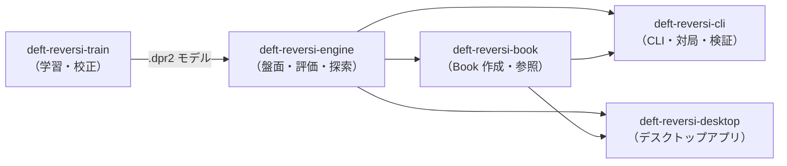

# 第1章 全体構成とワークスペース設計

## 1.1 全体のつながり

Deft Reversi は、リバーシの思考エンジンを中心に、学習ツール・Book 管理・CLI・デスクトップアプリを一つのリポジトリにまとめたプロジェクトです。それぞれの役割とデータの流れは次のようになっています。

| クレート | 主な役割 |
| --- | --- |
| `deft-reversi-engine` | 盤面の高速計算、局面の点数付け、先読み探索を担う中核ライブラリ |
| `deft-reversi-book` | 事前に調べた局面データベース（Book）の作成と対局時の検索 |
| `deft-reversi-train` | 棋譜データから評価モデルを学習し、枝刈り係数を調整する学習ツール |
| `deft-reversi-cli` | ターミナル対局、棋譜検討、問題集の検証、外部対局プロトコル |
| `deft-reversi-desktop` | GPUI で作ったデスクトップアプリ（バイナリ名 `deft-reversi`） |

※ Web 向けの `deft-reversi-web` は旧 API のまま残しているため、ビルド対象からは外しています。

## 1.2 エンジンを土台にした依存関係

すべての土台となる `deft-reversi-engine` は、ワークスペース内の他クレートに依存しません。外部ライブラリもデータの読み書きに使う最小限のものだけに絞っています。

エンジンの機能は、利用目的に合わせて **フィーチャフラグ** で出し分けます。

- **通常利用（Book・デスクトップアプリ）**: 対局や探索に必要な基本 API だけを使います。
- **学習・調整用途（学習ツール・CLI）**: `tuning` フィーチャを有効にし、評価モデルの組み立てや枝刈りパラメータの調整用 API も使います。

## 1.3 ビルド設定の工夫

リリースビルドでは、1 秒あたりの探索局面数を増やすために最適化を最大（`opt-level = 3`, `lto = "fat"`, `codegen-units = 1`）にしています。

あわせて、パニック時の挙動を `unwind` に設定しています。エンジンは複数の CPU スレッドで同時に先読みを行いますが、万が一子スレッドで異常が起きてもプロセスを即座に落とさず、親スレッド側で安全にタスクを回収できるようにするためです。

## 1.4 評価モデルファイル（DPR2 形式）

学習ツールで作った評価モデルの重みと枝刈りの調整データは、「DPR2」という独自のバイナリ形式で保存してエンジンへ渡します。

| バージョン | 中身 |
| --- | --- |
| 1 | 進行度 60 段階分のパターン評価重み（`i16`） |
| 2 | バージョン 1 の重み ＋ 枝刈り（ProbCut）の調整データ |
| 3 | 60 段階の評価重み ＋ 補助ニューラルネット（双方の合法手数を入力）＋ 任意の枝刈りデータ |
| 4 | 60 段階の評価重み ＋ 補助ニューラルネット（合法手数と石数を入力）＋ 任意の枝刈りデータ |

---

関連ソース: [Cargo.toml](../Cargo.toml), [deft-reversi-engine/src/lib.rs](../deft-reversi-engine/src/lib.rs), [deft-reversi-engine/src/model.rs](../deft-reversi-engine/src/model.rs)
