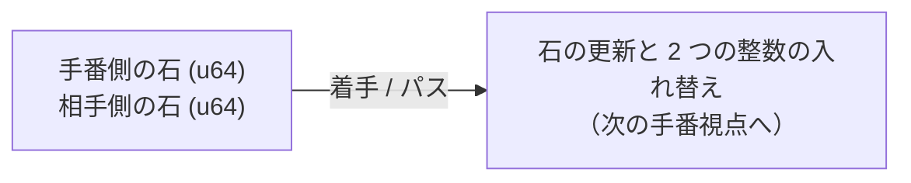
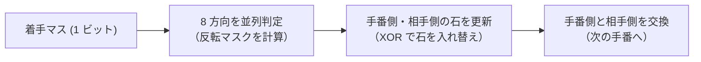
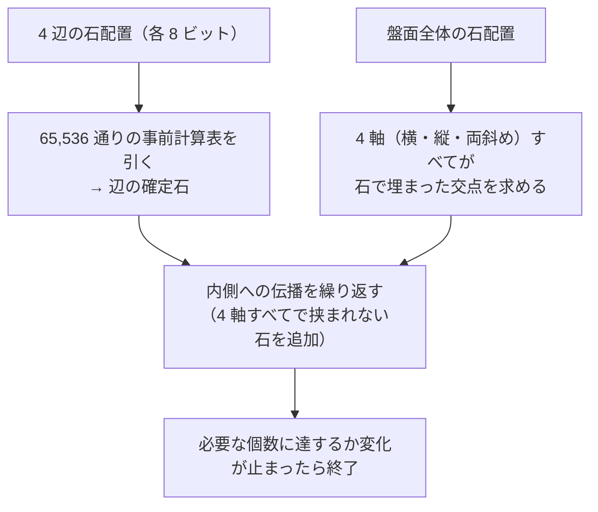

# 第2章 ビット演算：合法手生成・石反転・確定石

リバーシ AI の強さを支える土台は、1 秒間にどれだけ多くの未来の盤面を調べられるかという「盤面計算の速さ」です。先読みの探索では「打てる場所を探す」「石を裏返す」「次の手番へ進める」という処理が何百万回も繰り返されます。

この章では、8×8＝64 マスの盤面を 2 つの整数だけで表す**ビットボード**と、ループを使わずに盤面全体を一括で計算するビット演算の仕組みを説明します。

## 2.1 ビットボード：64 マスを 2 つの整数で表す

リバーシの盤の 64 マスを 2 次元配列で持つと、合法手を探したり石を数えたりするたびに 64 マスを順番に調べるループが必要になります。そこで、64 個のビット（0 と 1）が並ぶ **64 ビット符号なし整数（`u64`）を 2 つ** 使い、盤面全体を表します。

各ビットには、左上の A1 を最下位ビット（bit 0）、右下の H8 を最上位ビット（bit 63）として順番にマスを割り当てます。

```text
     A   B   C   D   E   F   G   H
 1 [ 0   1   2   3   4   5   6   7]  ← 最下位ビット (bit 0 = A1)
 2 [ 8   9  10  11  12  13  14  15]
 3 [16  17  18  19  20  21  22  23]
 4 [24  25  26  27  28  29  30  31]
 5 [32  33  34  35  36  37  38  39]
 6 [40  41  42  43  44  45  46  47]
 7 [48  49  50  51  52  53  54  55]
 8 [56  57  58  59  60  61  62  63]  ← 最上位ビット (bit 63 = H8)
```

さらに「黒石」「白石」という固定の区別ではなく、常に **「いま打つ側（手番側）」** と **「相手側」** の 2 つの整数で石の配置を持ちます。リバーシは黒番でも白番でもルールや有利不利の基準がまったく同じであるため、手番視点で持つことで先手・後手の条件分岐をなくせます。



どちらにもビットが立っていないマスは空きマス（`!(手番側 | 相手側)`）として計算できるため、盤面全体の状態は 2 つの整数だけで過不足なく表せます。

## 2.2 合法手の生成：8 方向をまとめて調べる

リバーシで石を置ける場所（合法手）は、「空きマスであり、上下左右・斜めの 8 方向のいずれかで相手の石を自分の石で挟めるマス」です。

1 マスずつ 8 方向にたどって調べる代わりに、ビット列全体を上下左右・斜めに対応するビット数（横は 1、縦は 8、斜めは 7 と 9）だけずらす**ビットシフト**を使います。自分の石から始めて、連続する相手石を「倍々シフト」で一気にたどり（Kogge-Stone 法）、その先に空きマスがあるかを 64 マス同時に判定します。

```text
1 方向（例：右方向 +1 シフト）のイメージ
  自分の石:   ● . . . . . . .
  相手の石:   . ○ ○ ○ . . . .
  連続伝播:   . ○ ○ ○ . . . .   ← 自分の石の隣から連続する相手石をたどる
  次のマス:   . . . . ★ . . .   ← その先が空きマスなら合法手（★）
```

ここで注意が必要なのは、盤面の「端の回り込み」です。64 ビット整数はメモリ上では 1 列のビット列なので、右端（H 列）のビットを右へ 1 つずらすと次の行の左端（A 列）へはみ出してしまいます。これを防ぐため、横方向と斜め方向の計算では左右の端の列（A 列と H 列）を除外するマスク（`0x7e7e7e7e7e7e7e7e`）を相手の石に掛けてからシフトします。

```text
回り込み防止マスク（0x7e7e...）
  A B C D E F G H
1 . * * * * * * .   ← A 列と H 列を 0 にすることで、
2 . * * * * * * .      行をまたいで隣の行へつながるのを防ぐ
  ...
```

CPU が **AVX2**（256 ビット幅の SIMD 命令）に対応している環境では、4 つの軸（シフト幅 1, 8, 9, 7）を 1 本の 256 ビットレジスタに並べて同時にシフトし、8 方向すべての合法手をさらに少ない命令数で求めます。

## 2.3 石の反転：置いたマスから 8 方向を裏返す

合法手に石を置くと、8 方向のうち「自分の石で相手の石を挟めた方向」にある石がすべて裏返ります。

ビットボードでは、着手した 1 ビットだけを立てたマスクから 8 方向に連続する相手の石をたどり、その先に自分の石がある方向だけを有効化して反転マスクを作ります。

- **汎用環境**: 8 方向それぞれについて、着手位置から連続する相手石を倍々シフトでたどり、終端に自分の石がある方向だけを結果へ合算します。
- **AVX2 環境**: 各着手マス（0〜63）ごとに 8 方向の直線マスクをあらかじめ配列に持っておき、256 ビットベクトル演算で 8 方向を並列に判定して反転マスクを組み立てます。



反転マスクが求まれば、手番側の石には「着手マスと反転マスク」を、相手側の石には「反転マスク」を排他的論理和（XOR）で反映し、両者を入れ替えるだけで着手が完了します。

## 2.4 残り 1 マスの高速計算

終盤の完全読み（勝ち負けや石差を最後まで読み切る探索）では、探索木の末端にあたる「残り 1 マス」の局面を膨大な回数計算します。この場面で毎回盤面を更新して石数を数え直すと、無駄な処理が積み重なります。

リバーシでは相手の石を 1 個裏返すと「自分の石が +1、相手の石が -1」になるため、石差は裏返した数の **2 倍** だけ動きます。そこで残り 1 マスでは盤面を更新せず、その空きマスに打ったときに裏返る石数の 2 倍を直接求めます。

CPU が **BMI2**（ビット操作拡張命令セット）に対応している環境では、次の仕組みで高速に計算します。

1. コンパイル時に、1 本のライン（8 マス）上の位置と石配置（256 通り）に対する「両側の反転数 × 2」の表を作っておきます。
2. 実行時は、着手マスを通る横・縦・斜め 2 方向の計 4 本のラインについて、専用命令（PEXT）などで各ラインの石配置を 8 ビットに抜き出します。
3. 4 本のラインそれぞれで表を引き、合計した値をそのまま石差の増分として使います。

## 2.5 確定石：絶対に裏返らない石を先読みに活かす

**確定石**とは、一度盤面に置かれたあと終局まで絶対に裏返らない石のことです。隅に置かれた石や、隅から途切れず並んだ辺の石がその代表です。

```text
    A B C D E F G H
 1  ● ● ● ● . . . ○   ← A1 が黒なら、A1〜D1 は絶対に裏返らない確定石
 2  ● ● . . . . . .   ← 横・縦・両斜めの 4 方向すべてで挟まれなければ内側も確定石になる
```

終盤の先読みで相手に多くの確定石を取られていると、残りの空きマスを自分がすべて取ったとしても逆転できないことが終局前に分かります。この「どれだけ頑張っても届く上限（スコアの上界）」を使うことで、最後まで読み切らなくても途中で探索を打ち切れます（Null-Window Search における上界枝刈り）。

確定石の判定は比較的コストが高いため、空きマス数に応じたしきい値や「相手石がすべて確定石だと仮定しても探索窓を超えないか」という事前チェックを通過した局面だけで実行し、計算は 2 段階で行います。



1. **辺の確定石（事前計算テーブル）**: 辺上の石が裏返るのは同じ辺上の空きマスに打たれたときだけなので、辺の状態だけで確定石が決まります。自分の石 8 ビットと相手の石 8 ビットの組（256 × 256 ＝ 65,536 通り）について、空きマスをどのような順で埋めても最後まで残る石をコンパイル時に動的計画法で計算しておき、実行時は上下左右の 4 辺それぞれで表を引くだけで求めます。
2. **盤面内側の確定石（4 方向からの伝播）**: 辺の確定石に加えて、横・縦・斜め 2 方向の 4 軸すべてが石で埋まっている交点はどの方向からも挟めないため、最初から確定石になります。これらを起点として「4 軸のそれぞれで、隣が確定石であるか、その軸のラインがすべて埋まっている」マスを確定石へ加えていく処理を繰り返します。枝刈りに必要な個数に達した時点で計算を打ち切れるため、不要な反復も省けます。

---

## 参考文献・出典

- Kogge, P. M., & Stone, H. S. (1973), *A Parallel Algorithm for the Efficient Solution of a General Class of Recurrence Equations*（Kogge-Stone 法による並列伝播）
- 奥原俊彦, *reversi/othello - bitboard tricks* および [edax-reversi-AVX](https://github.com/okuhara/edax-reversi-AVX)（ビットボード演算・AVX2 / BMI2 最適化の解説と実装）
- Richard Delorme, [Edax (`edax-reversi`)](https://github.com/abulmo/edax-reversi)（ビットボードによる合法手生成・石反転・確定石判定の実装）
- [Egaroucid 技術解説](https://www.egaroucid.nyanyan.dev/ja/technology/explanation/)（ビットボード表現・SIMD による高速化）

関連ソース: [board/mod.rs](../deft-reversi-engine/src/board/mod.rs), [board/bitboard.rs](../deft-reversi-engine/src/board/bitboard.rs), [board/moves.rs](../deft-reversi-engine/src/board/moves.rs), [board/flip.rs](../deft-reversi-engine/src/board/flip.rs), [board/last.rs](../deft-reversi-engine/src/board/last.rs), [board/stability.rs](../deft-reversi-engine/src/board/stability.rs), [board/edge_stability.rs](../deft-reversi-engine/src/board/edge_stability.rs)
