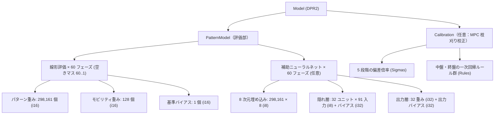
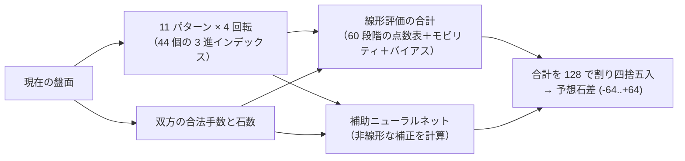
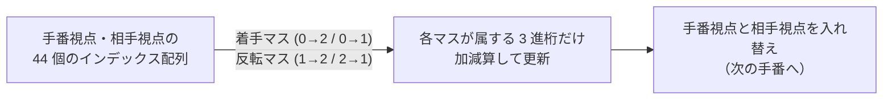
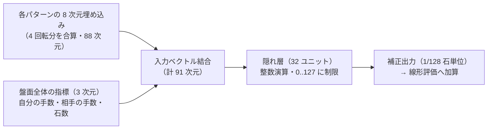

# 第3章 評価関数：パターン評価と補助ニューラルネット

リバーシの勝敗は終局時の石の数で決まりますが、途中の盤面では「いま石を多く持っている側」が有利とは限りません。むしろ序盤から中盤にかけては石を取りすぎると自分の打てる場所が減り、相手に隅や好手を譲ることになりやすくなります。

そこで先読みが終局まで届かない局面では、現在の盤面だけを見て「このまま進めば何石ほどの差で勝ちそうか（予想石差）」を数値で見積もる**評価関数**を使います。この章では、盤面の形から点数を見積もるパターン評価と、それを補う小型ニューラルネットの仕組みを説明します。

## 3.1 パターン評価：盤面の「形」に点数を付ける

64 マス全体の石の配置は天文学的な数になるため、すべての盤面に直接点数を付けることはできません。そこで「辺」「角の周辺」「斜めのライン」など、局面の良し悪しが表れやすい **11 種類の決まったマス群（パターン）** を切り出し、それぞれの形の点数を足し合わせる方法をとります。

パターンの各マスは「空き（0）」「相手石（1）」「自分石（2）」の 3 通りの状態をとります。$k$ マスのパターンであれば $3^k$ 通りの状態（たとえば 10 マスなら $3^{10} = 59,049$ 通り、8 マスなら $3^8 = 6,561$ 通り）に 3 進数の番号を割り当て、あらかじめ学習した点数表を引きます。

### 全 11 パターンの形（`X` が対象マス）

```text
[0] 辺＋2列目中央 (10マス)   [1] 辺＋2X (10マス)          [2] 2列目＋両隅 (10マス)
  A B C D E F G H              A B C D E F G H              A B C D E F G H
1 X . X X X X . X            1 X X X X X X X X            1 X . . . . . . X
2 . . X X X X . .            2 . X . . . . X .            2 X X X X X X X X
3 . . . . . . . .            3 . . . . . . . .            3 . . . . . . . .
  (以下 4〜8 行は .)           (以下 4〜8 行は .)           (以下 4〜8 行は .)

[3] 3列目 (8マス)            [4] 4列目 (8マス)            [5] 角 3×3 (9マス)
  A B C D E F G H              A B C D E F G H              A B C D E F G H
1 . . . . . . . .            1 . . . . . . . .            1 X X X . . . . .
2 . . . . . . . .            2 . . . . . . . .            2 X X X . . . . .
3 X X X X X X X X            3 . . . . . . . .            3 X X X . . . . .
4 . . . . . . . .            4 X X X X X X X X            4 . . . . . . . .
  (以下 5〜8 行は .)           (以下 5〜8 行は .)           (以下 5〜8 行は .)

[6] 角の三角形 (10マス)      [7] 角2×2＋斜め (9マス)      [8] 斜め 6マス (6マス)
  A B C D E F G H              A B C D E F G H              A B C D E F G H
1 X X X X . . . .            1 X X . . X . . .            1 . . . . . X . .
2 X X X . . . . .            2 X X . X . . . .            2 . . . . X . . .
3 X X . . . . . .            3 . . X . . . . .            3 . . . X . . . .
4 X . . . . . . .            4 . X . . . . . .            4 . . X . . . . .
5 . . . . . . . .            5 X . . . . . . .            5 . X . . . . . .
  (以下 6〜8 行は .)           (以下 6〜8 行は .)            6 X . . . . . . .
                                                            (以下 7〜8 行は .)

[9] 斜め 7マス (7マス)       [10] 主対角線 (8マス)
  A B C D E F G H              A B C D E F G H
1 . . . . . . X .            1 . . . . . . . X
2 . . . . . X . .            2 . . . . . . X .
3 . . . . X . . .            3 . . . . . X . .
4 . . . X . . . .            4 . . . . X . . .
5 . . X . . . . .            5 . . . X . . . .
6 . X . . . . . .            6 . . X . . . . .
7 X . . . . . . .            7 . X . . . . . .
8 . . . . . . . .            8 X . . . . . . .
```

| 番号 | 名称 | マス数 | テーブル要素数 |
| --- | --- | ---: | ---: |
| 0 | 辺＋2 列目中央 | 10 | $3^{10} = 59,049$ |
| 1 | 辺＋2X | 10 | $3^{10} = 59,049$ |
| 2 | 2 列目＋両隅 | 10 | $3^{10} = 59,049$ |
| 3 | 3 列目 | 8 | $3^8 = 6,561$ |
| 4 | 4 列目 | 8 | $3^8 = 6,561$ |
| 5 | 角 3×3 | 9 | $3^9 = 19,683$ |
| 6 | 角の三角形 | 10 | $3^{10} = 59,049$ |
| 7 | 角 2×2＋斜め | 9 | $3^9 = 19,683$ |
| 8 | 斜め 6 マス | 6 | $3^6 = 729$ |
| 9 | 斜め 7 マス | 7 | $3^7 = 2,187$ |
| 10 | 主対角線 | 8 | $3^8 = 6,561$ |
| **合計** | **全 11 パターン** | — | **298,161** |

11 種類すべての点数表を合計すると、1 段階あたり **298,161 個** の重みになります。

## 3.2 モデルの全体構造

評価モデルファイル（DPR2 形式）から読み込まれる `Model` は、進行度ごとの評価データと任意の枝刈り校正データをひとまとめにした構造になっています。



## 3.3 対称性の共有・進行度フェーズ・モビリティ

パターンごとの点数表をそのまま使うだけでなく、リバーシの性質に合わせた 3 つの工夫を組み合わせています。



- **4 回転で重みを共有**: 盤面を 90 度ずつ 4 方向に回転させても、形の良し悪しは変わりません。11 種類のパターンをそれぞれ 4 回転させた計 44 個の特徴量を参照し、同じ点数表を共有します。これにより、回転させただけの盤面は必ず同じ評価になり、学習データも 4 方向分まとめて活かせます。
- **進行度に応じた 60 段階のフェーズ**: 序盤で良いとされる形と終盤で良いとされる形は異なります。空きマス数（60 マスから 1 マスまで。空き 0 マスも最終段階に丸めます）に応じた **60 段階** の重みテーブルを持ち、ゲームの進行に合わせて参照先を切り替えます。
- **モビリティ（合法手数の差）とバイアス**: 盤面の形だけでなく「相手より多く打てる場所を持っているか」も重要です。自分の合法手数と相手の合法手数の差（`64 + 自分の合法手数 - 相手の合法手数` の 128 通り）にも重みテーブルを持ち、進行度ごとの基準値（バイアス）とともに加算します。

各重みは 1/128 石単位の整数（`i16`）で学習・保持しており、すべての合計を最後に 128 で割って四捨五入し、-64〜+64 の予想石差として探索へ返します。

## 3.4 差分更新：1 手ごとに全部数え直さない工夫

先読みの途中で 1 手進むたびに、44 個のパターンすべてを盤面全体から数え直すと大きな負担になります。リバーシでは 1 手で変化するマスは「石を置いた 1 マス」と「裏返った数マス」だけなので、変化した分だけを更新する**差分更新**を行います。



コンパイル時に「64 マスそれぞれが 44 個の特徴量のうちどれに属し、3 進数の何桁目（$3^k$）にあたるか」の対応表を作っておきます。着手時は、石を置いたマス（空き 0 → 自分 2）と裏返ったマス（相手 1 → 自分 2）の重みだけを配列全体へ足し引きします。

さらに、あらかじめ **「手番側から見たインデックス配列」** と **「相手側から見たインデックス配列」** の両方を同時に更新して持っておきます。こうしておくと、手番交代やパスのたびに 3 進数の各桁（1 と 2）を反転し直す必要がなく、2 つの配列を入れ替えるだけで次の手番の評価へ進めます。

## 3.5 補助ニューラルネットによる非線形補正

パターンごとの点数を単純に足し合わせる方式はとても高速ですが、限界もあります。たとえば「隅を取られたうえに相手の手数も多い」といったパターン同士の複雑な絡みや、盤面全体の石数と形の関係は、単純な足し算だけでは表現しきれません。

そこでモデルが対応している場合は、線形パターン評価に **小型の補助ニューラルネット** を併用します。



処理の流れは次のとおりです。

1. **パターンの埋め込み和（88 次元）**: 11 種類の各パターン状態に、線形重みとは別に 8 次元の埋め込みベクトル（`i8`）を持たせます。各パターンの 4 回転分のベクトルを足し合わせて 0〜127 の範囲に収め、11 パターン × 8 次元＝88 次元の特徴を作ります。
2. **盤面全体の指標（3 次元）**: 自分の合法手数（4 倍して上限 127）、相手の合法手数（同）、手番側の石数（2 倍して上限 127）の 3 つを並べます（旧形式のモデルでは双方の合法手数のみの 2 次元を使います）。
3. **隠れ層 1 層（32 ユニット）**: 計 91 次元の入力を 32 ユニットの隠れ層へ通し、1/128 石単位の補正値を出力して線形評価の合計に加えます。

探索中に重い浮動小数点演算を避けるため、このニューラルネットの推論は**すべて整数演算**で行います。隠れ層の重みを 4 入力ずつのグループに並べ替えておくことで、AVX2 に対応した CPU では並列積和命令を使って 32 ユニット分の積和を高速に計算できます。

---

## 参考文献・出典

- Buro, M. (1999), *From Simple Features to Sophisticated Evaluation Functions*（Logistello におけるパターン評価・進行度別重み学習）
- [Egaroucid 技術解説](https://www.egaroucid.nyanyan.dev/ja/technology/explanation/)（石評価パターン・差分計算・SIMD 積和）

関連ソース: [evaluation/mod.rs](../deft-reversi-engine/src/evaluation/mod.rs), [evaluation/pattern/definition.rs](../deft-reversi-engine/src/evaluation/pattern/definition.rs), [evaluation/pen.rs](../deft-reversi-engine/src/evaluation/pen.rs)
