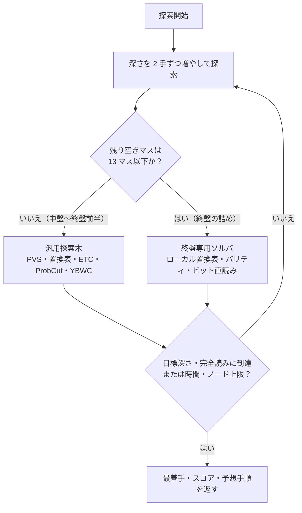
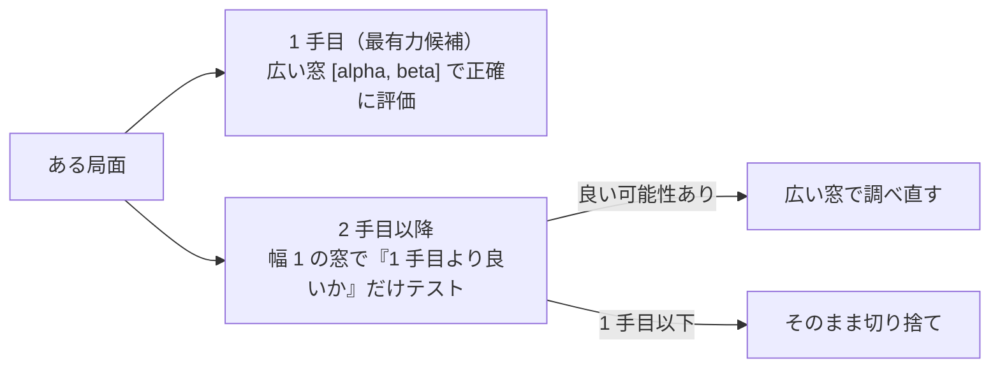

# 第4章 探索アルゴリズム：反復深化・PVS・置換表・終盤ソルバ

盤面の良し悪しを数値で見積もれるようになっても、1手先を見ただけでは相手の反撃を見落とします。互いに最善手を打ち合ったとき、最終的にどの手を選べば最も有利になるかを何手も先まで読む処理が **探索** です。

リバーシは1局で最大60手あるため、すべての手を最後までまともに調べると計算量が爆発してしまいます。本エンジンでは、探索の順序を工夫し、同じ局面の再計算を省き、終盤では専用の高速な処理へ切り替えることで、限られた時間の中で深く正確に読み切れるようにしています。

## 4.1 反復深化（2手刻み）とレベル設計

目標の深さ（たとえば16手先）をいきなり調べるのではなく、浅い深さから順番に深くしながら何度も探索し直す手法を **反復深化（Iterative Deepening）** と呼びます。



### なぜ浅い深さから2手刻みで読むのか

浅い深さから順に読むと、途中で見つけた「一番良さそうな手」や各局面の評価結果がキャッシュ（置換表）に蓄積されます。次の深い探索では、その有力な手から先に調べられるため、残りの悪い手を早い段階で切り捨てられるようになり、結果として最初から深く読むよりも速く終わります。

また、深さを1手ずつではなく **2手刻み** で増やすのには理由があります。リバーシでは手番が1手進むたびに「最後に打つ側」が入れ替わるため、奇数深さと偶数深さで評価値の振れ方が変わります。2手ずつ深くすることで自分の手番と相手の手番の条件が揃い、探索スコアの安定性が高まります。

### ウォームスタートと強さレベル（1〜60）

直前の対局や前の手番の探索結果が置換表に残っている場合は、その最善手とスコアを引き継いで初期の浅い反復をスキップする **ウォームスタート** を行います。

強さレベル（1〜60）を指定した探索では、中盤は選択率 83% でレベルと同じ深さまで読み、終盤に近づくと段階的に選択率（85% → 95% → 98% → 99%）を上げながら、最後は枝刈りのない完全読み（100%）へ移行します。完全読みを直接目標とする場合も、まず中盤の 83% 探索で置換表と着手順序を整え、続いて終盤の選択的探索（85%〜99%）を挟んでから最終的な完全読みに入る二段・三段構えのスケジュールを組みます。

## 4.2 アルファベータ法・PVS・Aspiration Window

探索木の枝を切り落とす基本となるのが **アルファベータ法** です。探索中は常に「探索窓 `[alpha, beta]`」を持ち回ります。

- `alpha`: 自分側が他の手ですでに確保している最低保証スコア（これ以下の手は選ぶ必要がない）
- `beta`: 相手側がすでに確保している上限スコア（これを上回る手を打たれるくらいなら、相手はそもそもこの局面へ進ませてくれないため、その場で探索を打ち切れる）

さらに本エンジンでは、これを高速化した **PVS（Principal Variation Search）** を採用しています。



着手順序の並べ替えがうまく機能していれば、1手目が最善手である確率が高くなります。そこで、1手目だけを広い窓 `[alpha, beta]` で正確に評価し、2手目以降は幅1の狭い窓（Null-Window：`[alpha, alpha + 1]`、Negamax では子ノードへ `[-alpha - 1, -alpha]` として渡します）で「1手目を超えないこと」だけを高速に確認します。もし1手目を超える手が見つかった場合だけ、広い窓で調べ直します。

### Aspiration Window とルート境界の再利用

探索の一番上の階層（ルート局面）では、深さ10を超える探索において **Aspiration Window** を使います。1つ前の反復で得た予測スコアの周辺だけに狭い窓を張って探索を始め、実際のスコアが窓の外へ出た場合だけ窓を段階的に広げて再探索します。このとき、各候補手について一度確定した上界・下界をルート側の配列に保持しておき、窓を広げた後の再探索でも無駄な計算を繰り返さないようにしています。

### 葉近傍の軽量化

探索木の末端に近い浅いノードでは、置換表の参照や候補手の並べ替えにかかるコストが、探索そのものより重くなることがあります。そこで本エンジンでは、Null-Window の中盤探索において次の2段階の軽量化を行っています。

- 残り深さが `SIMPLE_SEARCH_DEPTH`（4手）未満のノード：共有置換表の参照と登録を省略し、軽量な探索ルーチンへ流します。
- 残り深さが `ORDERED_SEARCH_DEPTH`（3手）未満のノード：候補手の並べ替えも省略し、盤面の評価関数を直接呼んで手早く折り返します。

## 4.3 ロックフリー置換表（seqlock）と PV 専用テーブル

リバーシでは打つ順番が違ってもまったく同じ盤面になることがよくあります。一度調べた局面のスコア（上界・下界）・最善手・次善手・探索深さ・品質（選択率）・世代番号を **置換表（Transposition Table）** に保存し、再び同じ盤面へ出会ったときに再利用します。

### 64バイトクラスタと seqlock 方式

共有置換表は、64バイトの CPU キャッシュラインに2つのスロット（各32バイト）を収めた 2-way 連想クラスタで構成されています。

```text
+-------------------------------------------------------------------+
| Cluster (64 bytes, 64-byte aligned)                               |
| +-------------------------------+-------------------------------+ |
| | Slot 0 (32 bytes)             | Slot 1 (32 bytes)             | |
| | - sequence (AtomicU64)        | - sequence (AtomicU64)        | |
| | - player   (AtomicU64)        | - player   (AtomicU64)        | |
| | - opponent (AtomicU64)        | - opponent (AtomicU64)        | |
| | - data     (AtomicU64: 8B)    | - data     (AtomicU64: 8B)    | |
| +-------------------------------+-------------------------------+ |
+-------------------------------------------------------------------+

[seqlock の読み取りと書き込み]
書き込み側: sequence が偶数のとき CAS で +1（奇数=書き込み中）にする
            → player, opponent, data を更新 → sequence を +2（偶数）に戻す
読み取り側: sequence を読む（奇数なら即ミス） → データを読み、再度 sequence を確認
            → 値が変わっていなければ有効、変わっていれば待たずにミス扱い
```

複数スレッドが同時に読み書きしてもミューテックスで待たされないよう、各スロットは **seqlock 方式** で保護しています。書き込み中は `sequence` を奇数にし、終わったら偶数に戻します。読み取り中に他スレッドの書き込みとぶつかった場合は、ロックの解放を待つのではなく単にキャッシュミスとして探索を続けます。スロットが埋まっているときは、探索世代が古いものや探索深さが浅いものを優先して置き換えます。

### PV 専用テーブルと ETC（事前置換表チェック）

完全読みの広い窓（PV ノード）で得られた結果は、探索木全体の軸になる重要な情報です。これが他の探索データで上書きされないよう、完全読みの PV 用に独立した **PV 専用テーブル** を設けています。

また、ある局面で候補手を1つずつ潜る前に、すべての子局面をまず置換表で一通り照会する **ETC（Enhanced Transposition Cutoff）** を行います（中盤は残り深さ4以上、終盤は空きマス数に応じた条件で適用）。子局面のいずれかがすでに `beta` 以上であると置換表に載っていれば、子ノードを展開せずに即座に枝刈りできます。逆に `alpha` 以下と分かっている手は候補リストからあらかじめ取り除き、残った手だけを探索します。

## 4.4 終盤専用ソルバ（空き13マス以下）

残り空きマスが13マス以下になると、評価関数による点数の見積もりは不要になり、終局まで読み切って正確な石差を算出します。この領域では1局面あたりの処理が非常に軽くなるため、汎用探索木と共有置換表のオーバーヘッドを避けて **終盤専用ソルバ** へ切り替えます。

```text
残り空きマス数に応じた探索の切り替え（完全読み・Null-Window）

  14 マス以上 : 汎用探索木（共有置換表 + ETC + ProbCut + YBWC 並列化）
  ---------------------------------------------------------------------
  13 マス以下 : 終盤専用ソルバ（LOCAL_END_MAX = 13、スレッド専有キャッシュ）
    ├─ 7〜13 マス : 4 象限パリティ + 相手合法手数による並べ替え + ローカル TT
    ├─ 5〜 6 マス : 孤立空きマス優先（空き 6 マスはローカル TT あり、5 マスはなし）
    └─ 1〜 4 マス : 合法手生成を省略し、空きマス周囲の相手石をビット直読み
```

### 確定石による上界枝刈り

終盤の完全読みでは、相手の「絶対にひっくり返らない石（確定石）」の数を数え、自分が残りのマスをすべて取っても到達できない最大スコア（上界）を算出します。この上界が `alpha` 以下であれば、それ以上探索を進めずに打ち切ります。

### スレッド専有のローカル置換表

空き6〜13マス（`TAIL_EMPTIES = 6` 〜 `LOCAL_END_MAX = 13`）の Null-Window 探索では、他スレッドと共有しない **ローカル置換表** を使います。空きマス数ごとの層に分かれており、各層は1024スロットで構成されています。スレッド間で競合しないため原子操作やキャッシュ同期のコストがかからず、スナップショットとして安全に境界値を読み取れます。

### 4象限パリティと孤立空きマス優先・ビット直読み

盤面を4つの 4×4 領域（象限）に分けたとき、空きマスが奇数個残っている領域は、お互いに打ち合うと自分がその領域の最後の手（手止まり）を取りやすくなります。

```text
  A B C D | E F G H
1 . . . . | . . . .
2 . . . . | . . . .   各 4x4 象限の空きマス数の偶奇（4 bit）を保持
3 . . . . | . . . .   → 空きが「奇数個」の象限を優先して探索
4 . . . . | . . . .
  --------+--------
5 . . . . | . . . .
6 . . . . | . . . .
7 . . . . | . . . .
8 . . . . | . . . .
```

空き7〜13マスでは、この4象限パリティと相手の合法手数（少ないほど有利）を組み合わせて候補手を並べ替えます。空き5〜6マスでは、周囲に他の空きマスが隣接していない「孤立空きマス」を優先して探索します。

さらに空き4マス以下になると、合法手リストを作る処理自体を省略します。空いているマスの周囲8方向に相手の石があるかをビット演算で直接確認し、打てる場所だけを試します。残り1マスでは石を置いたときの裏返し枚数から即座に最終石差を計算して返します。

---

## 参考文献・出典

- Knuth, D. E., & Moore, R. W. (1975), *An Analysis of Alpha-Beta Pruning*（アルファベータ探索）
- Reinefeld, A. (1983), *An Improvement of the Scout Tree-Search Algorithm* / Campbell, M. S., & Marsland, T. A. (1983)（PVS / NegaScout）
- Plaat, A., Schaeffer, J., Pijls, W., & de Bruin, A. (1996), *Best-First Fixed-Depth Minimax Algorithms*（ETC: Enhanced Transposition Cutoff）
- Richard Delorme, [Edax (`edax-reversi`)](https://github.com/abulmo/edax-reversi)（探索木・置換表・終盤探索の実装）
- [Egaroucid 技術解説](https://www.egaroucid.nyanyan.dev/ja/technology/explanation/)（ムーブオーダリング・4 象限パリティ・終盤専用探索）

**関連ソース**:
- 反復深化・スケジュール制御: [search.rs](../deft-reversi-engine/src/search.rs)
- 強さレベル表: [level.rs](../deft-reversi-engine/src/search/level.rs)
- ルート探索・Aspiration Window: [root.rs](../deft-reversi-engine/src/search/root.rs)
- 汎用探索木・PVS・ETC・軽量探索: [tree.rs](../deft-reversi-engine/src/search/tree.rs)
- ロックフリー置換表（seqlock）: [transposition.rs](../deft-reversi-engine/src/transposition.rs)
- 終盤専用ソルバ: [endgame/mod.rs](../deft-reversi-engine/src/search/endgame/mod.rs), [local_tt.rs](../deft-reversi-engine/src/search/endgame/local_tt.rs), [parity.rs](../deft-reversi-engine/src/search/endgame/parity.rs), [shallow.rs](../deft-reversi-engine/src/search/endgame/shallow.rs), [last_four.rs](../deft-reversi-engine/src/search/endgame/last_four.rs)
