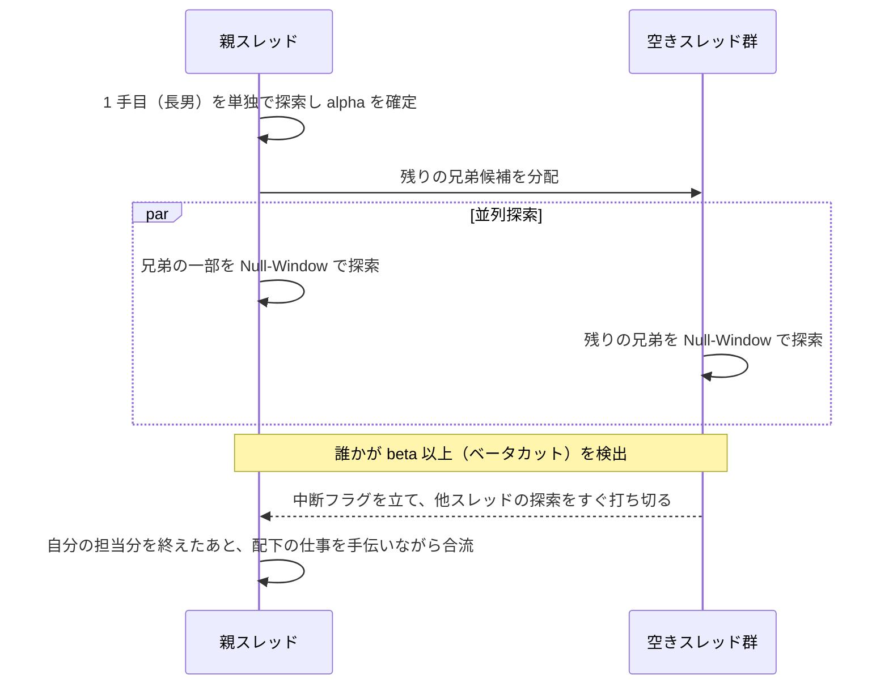

# 第5章 並列探索：YBWC とデッドロック回避

複数の CPU コアで探索を分担しようとするとき、候補手を最初からすべて別々のスレッドへ配るだけでは速くなりません。アルファベータ法や PVS では、「1 手目の結果（`alpha`）が決まってから、2 手目以降をその基準で切り捨てる」という順番が重要になるためです。

1 手目の結果が出る前に 2 手目や 3 手目を同時に調べ始めると、本来なら切り捨てられるはずだった枝まで深く読んでしまい、スレッドを増やしたのにかえって遅くなることがあります。本エンジンでは **YBWC（Young Brothers Wait Concept）** と **待機中の親スレッドが自分の子孫だけを手伝う仕組み** により、無駄な探索とデッドロックの両方を防いでいます。

## 5.1 YBWC（Young Brothers Wait Concept）の仕組み

YBWC の考え方はシンプルです。「一番有望そうな 1 手目（長男）だけは 1 つのスレッドで最後まで調べ切り、探索窓の基準となる `alpha` を決めてから、残りの候補手（兄弟）を空いているスレッドへ配る」という手順をとります。



兄弟の候補手は幅 1 の窓（Null-Window）で並列に調べます。途中でいずれかのスレッドが `beta` 以上の手を見つけてベータカットが起きたら、共有の中断フラグを立てます。同じ分割点の他の兄弟を調べていたスレッド（およびその下位の探索）は、このフラグを定期的に確認して探索をすぐ打ち切り、親スレッドへ合流します。

最初の分配時にすべてのスレッドがふさがっていた場合でも、担当の 1 手を調べ終えるたびに空きスレッドが増えているかを確認し、途中からでも残りの候補手を他のスレッドへ渡せるようにしています。

## 5.2 分割条件とオーバーヘッドの制御

並列探索では、スレッドへ仕事を渡して完了を待つためのオーバーヘッドがかかります。残りの探索量が小さい浅い局面まで分割すると、並列化で減る計算量よりも管理コストのほうが大きくなってしまいます。

そのため、並列分割を行うのは次の条件をすべて満たす場合だけに絞っています。

- **中盤の最小深さ（4 手以上）**: 残り探索深さが 4 手以上の局面だけで分割します。終盤完全読みの直前に行う浅い準備探索でもスレッドが遊ばないようにこの深さに設定しています。
- **終盤の最小空きマス数（10 マス以上、多スレッド時は引き上げ）**: 選択的終盤探索や 8 スレッド未満の環境では、空き 10 マス以上で分割します（ただし空き 13 マス以下は終盤専用ソルバで動くため、14 マス未満ではルート局面以外は分割しません）。8 スレッド以上で最終の完全読みを行うときは空きスレッドが余りやすいため、最小空きマス数を `13 + min(threads, 16) / 4`（20 スレッドなら 17 マス）まで引き上げ、細かすぎる分割による待ち時間を減らしています。
- **候補手数と空きスレッド**: 分割開始時は残りの候補手が 3 手以上（途中からの追加募集時は 2 手以上）あり、かつ空いているスレッドがあるときだけ分割します。
- **ProbCut の確認探索では分割しない**: 枝刈り判定用の浅い確認探索の中では並列分割を行いません。

## 5.3 デッドロックを防ぐ仕組み

木構造の並列探索で起こりやすい不具合が、スレッド同士が互いの完了を待ち合って止まってしまう **デッドロック** です。

### なぜ共有の待ち行列（グローバルキュー）だと危険なのか

一般的なスレッドプールでは、発生した仕事を 1 つの共有キューに積み、空いたスレッドが自由に仕事を取り出します。しかし並列探索でこれを行うと、次の流れでデッドロックが起きる恐れがあります。

1. 親スレッド A が子タスク B を別スレッドへ渡し、B の完了を待つ。
2. A が待っているあいだに、共有キューからまったく無関係な別の仕事 C を引き受ける。
3. C の先でさらに別スレッドの待ちが発生し、全スレッドが他人の仕事の完了待ちに入ってしまうと、肝心の子タスク B を実行できるスレッドがいなくなり、全体が永久に止まる。

### 解決策：1 件枠の受け口と「自分の子孫だけを手伝う」ルール

本エンジンでは共有キューを使わず、次の 2 つのルールでデッドロックを構造上なくしています。

```text
[共有キュー方式（危険）]
  親スレッド A ──(子 B の完了待ち)──× 進めない
       └─ 空き時間に無関係な仕事 C を取得 → 全員が他人の待ちに入り停止する恐れ

[本エンジンの方式（安全）]
  各ワーカースレッド : 仕事を 1 件だけ受け取れる枠を持つ（8 MiB スタック）
  親スレッド A       : 合流待ちのあいだ「自分の子孫の仕事」だけを受け付ける
       │
       ├── 仕事の依頼先を探す順:
       │     1. 合流待ちをしている最も近い祖先スレッドへ直接渡す
       │     2. 空いているワーカースレッドへ渡す
       │     3. 全員ふさがっていれば分割せず、自分でそのまま実行する
       │
       └── 親スレッド A が受け取るのは自分の配下の仕事だけなので循環待ちが起きない
```

1. **キューに溜めない受け渡し**: 起動時にスレッド数分のワーカースレッド（各 8 MiB スタック）を用意し、それぞれに仕事を 1 件だけ受け取れる枠を持たせます。仕事を配るときに空きスレッドが見つからなければ、キューに積んで待つのではなく、元のスレッドが自分でその候補手を探索します。
2. **自分の子孫だけを手伝う**: 親スレッドが自分の担当分を終えて他スレッドの合流を待つあいだは、自分の配下から枝分かれした **子孫ジョブだけ** が依頼できる受け口を開きます。子孫がさらに分割するときは、まず最も近い待機中の祖先スレッドへ直接仕事を渡し、受け手がなければ空いているワーカーへ渡します。

親スレッドは自分の子孫の仕事しか引き受けないため、「完了を待っている相手を自ら手伝って早く終わらせる」ことしか起きません。無関係なタスクの待ちに巻き込まれることはなく、パニックでスタックを巻き戻す場合も、必ず子孫ジョブの完了を待ってから抜けるため、未回収のジョブは残りません。

## 5.4 キャッシュ競合の回避とローカルキャッシュの退避

複数スレッドが頻繁にフラグを読み書きしながら探索するため、CPU キャッシュの扱いも性能に影響します。

- **128 バイト境界での配置分離**: 異なるスレッドが同じ CPU キャッシュライン（隣接ラインのプリフェッチを含めると 128 バイト）上の別々の変数を書き換えると、キャッシュの同期が頻発して速度が落ちます（偽共有）。そこで、分割点の共有状態・中断フラグ・待機中祖先の受付フラグ・統計カウンタなどは 128 バイト境界（`#[repr(align(128))]`）に揃えて配置しています。
- **合流待ち中のローカル終盤キャッシュの退避**: 第 4 章で説明したとおり、空き 13 マス以下の終盤探索ではスレッド専有のローカル終盤キャッシュを使います。親スレッドが合流待ちに入って子孫の仕事を手伝うときは、その直前にローカルキャッシュをスレッド固有の一時領域へ預け、手伝う子孫ジョブがそのまま使えるようにしています。合流が終わったら親スレッドへ戻して探索を続けます。モデルや設定が変わった際に古いキャッシュが混ざらないよう、世代番号（エポック）の一致も確認しています。

---

## 参考文献・出典

- Feldmann, R., Mysliwietz, P., & Monien, B. (1994), *Studying Overheads in Massively Parallel Min/Max-Tree Evaluation*（YBWC: Young Brothers Wait Concept）
- [Egaroucid 技術解説](https://www.egaroucid.nyanyan.dev/ja/technology/explanation/)（YBWC によるマルチスレッド並列探索）

**関連ソース**:
- スレッドプール・メールボックス・祖先ヘルパー: [parallel.rs](../deft-reversi-engine/src/parallel.rs)
- YBWC 分割点・合流制御: [ybwc.rs](../deft-reversi-engine/src/search/ybwc.rs)
- 分割閾値（`SPLIT_DEPTH`, `SPLIT_EMPTIES`）: [tree.rs](../deft-reversi-engine/src/search/tree.rs)
- ローカル終盤キャッシュの退避・復元: [local_tt.rs](../deft-reversi-engine/src/search/endgame/local_tt.rs)
