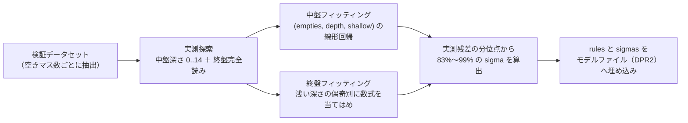

# 第6章 MPC（Multi-ProbCut）と枝刈り・校正

アルファベータ法や PVS は「確実に最善手を変えない範囲」でしか枝を切り捨てません。しかし実戦的な強さを追求するには、「浅く読んだ時点で大きく負けている手は、深く読んでもまず逆転できない」という統計的な性質を利用して、見込みの薄い枝を早い段階で切り落とす仕組みが有効です。これが **Multi-ProbCut（MPC）** です。

MPC は評価関数の精度に大きく依存するため、評価モデルごとに実際の対局局面を使ってパラメータを計測・調整（校正）する必要があります。

## 6.1 ProbCut の基本原理と一次回帰モデル

ある局面において、目標の深い探索（深さ $d$ または終盤完全読み）で得られるスコアを $v_d$、それよりずっと浅い探索（深さ $s$、ProbCut を使わない純粋な探索）で得られるスコアを $v_s$ とします。多くの局面を調べると、$v_s$ と $v_d$ の間には強い線形関係があることが分かります。

$$v_d \approx \text{slope} \times v_s + \text{intercept}$$

この予測には一定のばらつき（標準偏差 `deviation`）が伴います。そこで、目標とする信頼度に応じた倍率 `sigma` を掛け、浅い探索の結果だけで「真のスコアが探索窓の外側にある」と高い確率で言い切れる境界（`high` と `low`）を逆算します。

```text
浅い探索のスコア v_s から深い探索のスコア v_d を予測するイメージ

         |             予測分布（標準偏差 deviation）
         |                 . * * .
  beta --+---------------*---------*----------------  ← ここから上ならベータカット
         |             *   ^         *
         |                 | sigma * deviation の余裕を見る
         |           *     |           *
 alpha --+---------*-------+-------------*----------  ← ここから下ならアルファカット
         |
         +------------------------------------------→ v_s
                  low                   high
```

- ベータカットの判定: 浅い探索を狭い窓 `[bound - 1, bound]` で行い、結果が `bound = ceil((beta - intercept + sigma * deviation) / slope)` 以上であれば、深く読んでも `beta` 以上になる可能性が高いため、その場で探索を打ち切ります。
- アルファカットの判定: 同様に `bound = floor((alpha - intercept - sigma * deviation) / slope)` 以下であれば、深く読んでも `alpha` 以下に沈む可能性が高いため、その場で打ち切ります。

### 誤刈りを防ぐ3つの安全策

1. Null-Window ノード限定: 広い探索窓を持つノード（PV ノード）で誤って枝を切ると読み筋全体が崩れるため、ProbCut は `beta - alpha == 1` の Null-Window ノードだけで実行します。
2. 静的評価による事前スクリーニング: 浅い探索すら毎回走らせると逆に遅くなるため、まず現在の盤面の静的評価値から一次式で予測スコアを計算し、それが `high` や `low` から一定のマージン（下界側は 4.0 石、上界側は中盤 8.0 石・終盤 2.0 石）以上離れていて明らかに届きそうにない場合は、浅い探索自体をスキップします。
3. 終盤完全読みの偶数丸め: 標準的なリバーシの完全読みスコアは必ず偶数になるため、終盤完全読みで ProbCut によるカットが起きたときは、返却する境界値を適切な偶数へ丸めて奇数窓が上位へ漏れないようにします。

## 6.2 5段階の選択率（83%〜99%）と実測分位点

本エンジンでは、探索の正確さと速度のバランスを次の5段階の選択率（`Selectivity`）で制御します（これに確率的枝刈りを行わない 100% 完全探索が加わります）。

| ステージ | 選択率 | 主な用途 |
| --- | --- | --- |
| `Percent83` | 83% | 強さレベル指定時の中盤探索、完全読み前のウォームアップ |
| `Percent85` | 85% | 終盤の選択的探索の入り口 |
| `Percent95` | 95% | 終盤の選択的探索の中間段階 |
| `Percent98` | 98% | 終盤の選択的探索の高精度段階 |
| `Percent99` | 99% | 完全読み直前の最終選択段階 |
| `Full` | 100% | ProbCut を行わない完全探索（品質タグ 0） |

### なぜ正規分布の理論値ではなく実測分位点を使うのか

教科書的な ProbCut では、誤差が正規分布に従うと仮定して $\sigma$ の倍率（たとえば両側 95% なら `1.960`、99% なら `2.576`）を理論値で与えます。しかし実際のゲーム木探索における誤差分布は正規分布よりも裾が重く、まれに大きな予測外れが起きます。理論値をそのまま使うと、想定している割合以上に誤った枝刈りが発生してしまいます。

そこで本エンジンの校正ツールでは、実際に探索して集めた全サンプルペア上の標準化残差

$$z = \frac{|v_{\text{deep}} - (\text{slope} \cdot v_{\text{shallow}} + \text{intercept})|}{\text{deviation}}$$

を計算して昇順に並べ、その分布の **83%〜99% の実測分位点** を `sigma` として採用します（ステージが上がるにつれて値が下がらないよう単調非減少に補正します）。

### 終盤準備ステージでの打ち切り設定

完全読みを目標とするとき、直前の選択的準備ステージでは空き13マスで終盤 ProbCut を打ち切ります（通常の選択的終盤探索では空き12マスまで）。これにより、空き12マス以下のローカル終盤キャッシュに保存される結果は枝刈りなしの完全読み扱い（品質タグ 0）となり、直後の最終完全読みステージへキャッシュをそのまま持ち越せます。

## 6.3 モデルごとの自動校正パイプライン

評価関数の重みが変わると予測の傾き・切片・ばらつきも変化するため、学習済みモデルごとに専用の校正コマンド（`train mpc`）でパラメータを算出し、モデルファイル（DPR2 形式）へ直接埋め込みます。



### 1. 実測データの収集

データセット（既定では検証用分割）から、指定した空きマス数範囲（既定 12〜52 マス）ごとに一定数（既定 64 局面）の局面を抽出し、ProbCut なしの全幅探索で深さ 0〜`max_depth`（既定 14）の評価値を計測します。あわせて終盤範囲（既定 12〜24 マス）については終局までの完全読みスコアも計測し、中断・再開できる TSV ファイルとして保存します。

### 2. 中盤ルールのフィッティング

計測した `(exact=false, empties, depth)` の各セルで最小二乗直線を求めて `slope`, `intercept`, `deviation` を得たあと、`(1, empties, depth, shallow_depth)` を説明変数とする線形回帰モデルを当てはめます。これにより、実測していない深さ（4〜60手）のルールも連続的に外挿して生成します。外挿された `deviation` が極端な値にならないよう、実測された最小・最大の範囲に収めています。

### 3. 終盤ルールのフィッティング（浅い深さの偶奇別）

終盤の完全読みルールでは、浅い探索の深さ $s$ の **偶奇別** に異なる数式を当てはめます。奇数深さの探索値は「手番側が評価誤差の乗った最善子ノードを選ぶ」ことで生じる未相殺のバイアスを含み、偶数深さとは $s$ に対する傾きの向きが逆になるためです。

- 傾きと切片: 空きマス数 $e$ と浅い深さ $s$ の一次関数として重み付き最小二乗法で求めます（実測最大空きマス数で頭打ちにします）。
- ばらつき（`deviation`）: 次の飽和モデルを仮定し、対数等間隔グリッドで $\lambda$ を探索して二乗誤差が最小となる係数を決定します。

$$\text{deviation}^2 = (c_0 + c_1 s + c_2 s^2) \cdot \left(1 - \exp\left(-\frac{e - s}{\lambda}\right)\right)$$

この式により、残り手数 $e - s$ が増えるにつれて誤差が徐々に飽和していく性質を自然に表現でき、実測した範囲外の大きな空きマス数に対しても無理のないルールを生成できます。

### 4. モデルへの統合

生成したルール群と5段階の `sigma` 倍率は、妥当性検証（傾き・偏差が正で有限であること、ステージ配列がエンジンの定義と一致することなど）を通したうえで DPR2 形式のモデルファイルへ書き込まれます。旧形式のモデルを扱う場合は、参照エンジン互換の静的テーブルへフォールバックする変換機能も備えています。

---

## 参考文献・出典

- Buro, M. (1995), *ProbCut: An Effective Selective Extension of the Alpha-Beta Algorithm*（ProbCut の原論文）
- Buro, M. (1997 / 1999), *Experiments with Multi-ProbCut and a New High-Quality Evaluation Function for Othello*（Multi-ProbCut）
- [Egaroucid 技術解説](https://www.egaroucid.nyanyan.dev/ja/technology/explanation/)（選択率ステージと MPC の運用）

**関連ソース**:
- 探索中の ProbCut 判定・浅い確認探索: [tree.rs](../deft-reversi-engine/src/search/tree.rs)
- 選択率ステージ・レベルとの対応: [api.rs](../deft-reversi-engine/src/search/api.rs), [level.rs](../deft-reversi-engine/src/search/level.rs)
- 終盤準備ステージの打ち切り定数: [endgame/mod.rs](../deft-reversi-engine/src/search/endgame/mod.rs)
- 旧形式互換 ProbCut ルール: [engine/src/mpc.rs](../deft-reversi-engine/src/mpc.rs)
- モデルごとの校正パイプライン: [train/src/mpc.rs](../deft-reversi-train/src/mpc.rs)
