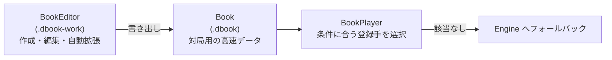
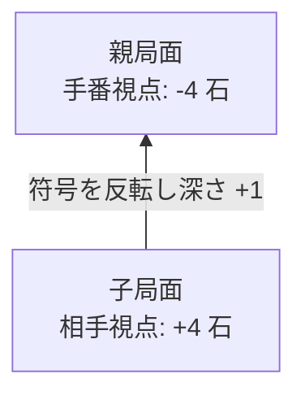

# 第7章 Book データの構造と生成

## 7.1 なぜ Book が必要か

序盤から中盤にかけてのよく現れる局面を毎回その場で深く先読みすると、持ち時間を大きく使ってしまいます。そこで「この局面でこの手を打てば何石差になるか」を事前に探索して保存しておくデータベースを **Book** と呼びます。

`deft-reversi-book` クレートは用途に応じて 3 つの役割に分かれています。



探索エンジン（`Engine`）自体は探索の内部で Book を読みません。対局時はまず `BookPlayer` が `Book` を調べ、設定した品質条件を満たす手がないときだけ `Engine` の通常探索へ渡します。

## 7.2 盤面の正規化：対称な 8 通りを 1 つにまとめる

リバーシの盤面は、90 度ずつの回転と左右反転を組み合わせると 8 通りの見た目があります。しかしゲームの性質としてはすべて同じ局面です。別々に保存すると容量も探索時間も 8 倍かかってしまうため、8 通りのうち代表となる 1 つの向きに揃えて（正規化して）保存します。

```text
  元の盤面 ──(回転・反転で代表の向きへ)──▶ Book 内の 1 エントリ
  候補手   ◀──(逆変換で元の向きへ戻す)─── 登録された着手
```

局面を表すキーも「手番側の石」と「相手側の石」の 2 つの整数だけで構成され、黒番・白番の区別は持ちません。対局時に候補手を返すときは、検索時に使った対称変換を逆向きに掛けて元の盤面の座標へ戻します。

## 7.3 作業用と対局用の 2 種類のファイル

Book には、育てるための作業用ファイル（`.dbook-work`）と、対局で使う読み取り専用ファイル（`.dbook`）があります。

- **`.dbook-work`**: 局面同士の親子関係や手動編集、中断した生成ジョブの再開状態まで保持します。
- **`.dbook`**: 対局中に素早く引けるよう、局面配列と候補手配列を並べてハッシュ索引で引くだけの単純な構造に絞っています。評価値の実体も共有テーブルへまとめて重複を省きます。

どちらのファイルも先頭に識別子と本文全体の SHA-256 ハッシュ値を持ちます。保存時は一時ファイルへ書き出してディスクへ同期したあとリネームで差し替えるため、途中で終了しても元のファイルは壊れません。

## 7.4 評価値の種類と親局面への伝播

Book に記録するスコアには 2 種類あります。

- **推定値**: 中盤・終盤探索による評価値です。正確な 1 点（点評価）、少なくともこれ以上（下界）、多くともこれ以下（上界）の 3 通りがあります。
- **確定値**: 終局までの完全読みで保証された最終石差の範囲（上下が一致していれば 1 点に確定）です。

子局面を深く調べ直して評価が更新されたら、点数の符号を反転させて親局面のその手の評価へ反映します（**バックアップ**）。たとえば子局面が相手視点で +4 石なら、親局面からその手を打った場合は -4 石になります。



推定値は評価モデルや探索設定が変わると基準がずれるため、モデルと設定から計算した識別ハッシュが一致する場合だけ再利用します。一方、完全読みで確定した結果だけはモデルに依存しないため、設定が変わっても使い続けられます。

## 7.5 Book の自動生成と拡張

Book を自動で育てるとき、すべての候補手を 1 手ずつ同じ深さで総当たりすると時間がかかりすぎます。そこで、すでに登録されている子局面の評価を再利用しつつ、残りの未登録手だけをまとめて調べる「集合探索」を使います。集合探索を使うと、最善手の正確な点数と、それ以外の劣る手の上界だけを効率よく求められます。

1 サイクルは次の流れで進みます。

1. 探索対象の局面と未登録手の集合を決める（`prepare`）
2. 複数スレッドで並列に探索する
3. 結果を反映し、最善手から許容損失（既定 2 石）以内の手を Book へ登録して次の局面をキューへ積む

次にどの局面を調べるかは、幅優先で均等に広げる方式と、有望な枝や評価のズレが大きい局面を優先する方式（16 回に 1 回は幅優先へ戻して偏りを防ぐ）を選べます。

## 7.6 対局時の着手選択

対局時は `BookPlayer` が「最低限必要な探索深さと選択率」（既定は中盤深さ 12・選択率 95%、終盤選択率 85%）を満たす手だけを選びます。

実際に打つ手として選ばれるのは正確な点評価を持つ手だけです。上界しか分からない手は「最善手よりこれだけ損をする」という比較用として使います。指定により、最善手だけを選ぶことも、許容損失以内の手からランダムに選ぶこともできます。

---

関連ソース: [deft-reversi-book/src/lib.rs](../deft-reversi-book/src/lib.rs), [symmetry.rs](../deft-reversi-book/src/symmetry.rs), [grow.rs](../deft-reversi-book/src/grow.rs), [player.rs](../deft-reversi-book/src/player.rs)
