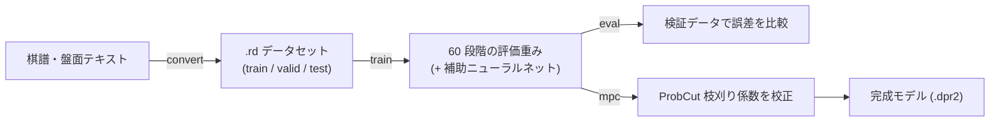

# 第8章 評価関数の学習パイプライン

## 8.1 評価関数はどうやって賢くなるか

第 3 章で説明したパターン評価の点数表は、人間が手作業で作るのではなく、大量の対局結果から自動で学習します。「途中の盤面から終局まで打ったとき、最終的に何石差になったか」というデータを何億局面も集め、予測スコアと実際の終局石差のズレが最小になるように点数表を調整します。

学習の全体の流れは次のとおりです。

## 8.2 学習データセットの作成

`convert` コマンドは、棋譜や盤面テキストを高速に読み込めるバイナリ形式（`.rd`）へ変換します。1 局面あたり「手番側の石」「相手側の石」「最終石差」の 18 バイトだけを記録します。

棋譜から変換するときは、終局の勝敗と結びつきが弱い序盤のランダム手などを除外し、残りの局面を盤上の石数ごとのフォルダ（`phase_<NN>/`）へ振り分けます。また、各局面は回転・反転の 8 通りを同一視したハッシュ値で訓練用（98%）・検証用（1%）・テスト用（1%）に分けるため、対称な盤面が訓練データとテストデータの両方に混ざるのを防げます。

## 8.3 フェーズ別の線形パターン重み学習

リバーシは序盤・中盤・終盤で良い手の基準が大きく変わるため、進行度に応じた 60 段階ごとに独立した点数表を用意し、複数スレッドで並列に学習します。既定ではパターンの状態とその左右反転・鏡像で重みを共有し、対称な盤面が必ず同じ点数になるようにします。

最適化には、出現頻度に応じて学習幅を自動調整する **AdaGrad**、重みが大きくなりすぎるのを防ぐ **L2 正則化**、極端な外れ値の影響を抑える **Huber 損失** を使います。1 周（1 エポック）ごとにチェックポイントを保存するため、途中で止めても再開できます。

### 学習の安定化と過学習の抑制

- **テーブルの中心化**: パターン重みと定数バイアスの間では定数を自由にやり取りできるため、学習を続けると各テーブルの平均値が 0 からずれていきます。そこで各パスの終わりにテーブルの平均をバイアス側へ移し、テーブルの平均を 0 に揃えます。
- **珍しい形の縮小（shrink）**: データに数回しか現れないパターンに大きな重みが付くと、ノイズを丸暗記してしまいます（過学習）。モデルを書き出す際は、出現回数 `n` が少ない重みほど `n / (n + shrink)` を掛けて 0 へ寄せます。
- **未学習フェーズの補完**: データセットに局面が 1 つもない段階は、最も近い学習済み段階の重みをコピーして補います。

## 8.4 補助ニューラルネットの同時学習

線形パターン評価とあわせて小型の補助ニューラルネットを学習する場合は、役割に応じて更新方法を変えています。

- **パターン埋め込みと線形重み**: 1 局面ごとに AdaGrad で更新
- **隠れ層と出力層の全結合層**: ミニバッチ（既定 256 局面）の平均勾配を使って Adam で更新

各パスの終わりには補助ニューラルネットの平均出力を線形バイアス側へ移し、両者の間で定数の基準が偏らないように揃えます。

## 8.5 モデルの評価と ProbCut 校正

学習が終わったら、`eval` コマンドでテストデータに対する平均絶対誤差（MAE）を測り、従来のモデルより予測精度が上がっているかを比べます。

最後に、`mpc` コマンドで探索中の枝刈り（ProbCut、第 6 章参照）の係数を調整します。ProbCut は「浅い探索のスコアから深い探索のスコアを一次式で予測し、見込みのない手を早めに切り落とす」手法ですが、予測の傾きやばらつきは評価モデルの精度によって変わります。

そのため、完成したモデルを実際に使って中盤（深さ 4〜14）と終盤の探索結果を実測し、線形回帰モデルや誤差の分位点から枝刈りの基準値を求めます。この結果をモデルへ埋め込んで、対局で使える完成ファイル `model.dpr2` が出力されます。

---

関連ソース: [deft-reversi-train/src/main.rs](../deft-reversi-train/src/main.rs), [phase.rs](../deft-reversi-train/src/phase.rs), [mpc.rs](../deft-reversi-train/src/mpc.rs)
