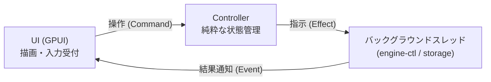
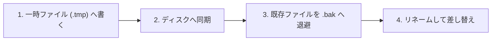

# 第9章 デスクトップアプリと CLI の設計

## 9.1 デスクトップアプリの全体構造

デスクトップアプリ `deft-reversi-desktop` は GPUI を使った GUI アプリです。画面描画、アプリの状態管理、重いバックグラウンド処理（探索やディスク保存）を切り分け、AI が深く考えている間も画面の操作が固まらないようにしています。

- **起動の工夫**: ウィンドウを開く前に評価モデル（`deft-eval-v4.dpr2`）の読み込みやサービススレッドの起動を始め、体感の起動時間を短くしています。置換表のメモリ確保に失敗したときは、128 MiB から下限 16 MiB まで半分ずつ減らしながら自動で再試行します。また、ロックファイルを使って同じデータフォルダでの多重起動を防ぎます。
- **テストしやすい純粋設計**: 状態遷移を担当するコントローラは、ウィンドウやスレッドを直接触りません。「探索を開始する」「効果音を鳴らす」といった外部への働きかけは指示のリストとして返すだけなので、GUI を立ち上げずに単体テストで対局や解析のロジックを検証できます。

## 9.2 局面解析と非同期スレッドの制御

解析機能では、状況に応じて 3 つの動きを使い分けます。

1. **表示中局面の段階的解析**: レベル 1 → 4 → 8 → 12 … と少しずつ読みを深くします。全候補手をまとめて 1 回で調べるのではなく 1 手ずつ個別に探索するため、最善手から順に結果が確定し次第すぐ画面へ表示できます。
2. **完全解析**: ユーザー操作に応じて、枝刈りなしの終局読み（選択率 100%）を実行します。
3. **棋譜全体の一括解析**: 置換表のキャッシュを再利用しやすいよう、終局側から初手へ向かって遡りながら各局面を評価します。

重い処理は 2 本の専用スレッドに逃がしています。

- **探索エンジン制御スレッド**: 同時に 1 つの探索または Book 生成を実行します。画面への進捗通知が多すぎて描画が重くならないよう、最小 66 ms 間隔（約 15 fps 上限）に間引いて通知します。対局用 Book が有効なときは探索前に照会し、登録手があればすぐ結果を返します。
- **永続化スレッド**: 設定や棋譜の保存を 1 本のスレッドに集約します。棋譜の自動保存では、最後の変更から 200 ms 待ってから書き出すデバウンス処理（連続操作でも最大 1 秒以内には保存）を入れ、Undo や着手を連打したときの無駄なディスク書き込みを抑えています。

## 9.3 安全なファイル保存（アトミック永続化）

設定ファイル（`settings.json`）や棋譜ファイル（`.dreversi`）を保存する際、書き込み途中で強制終了してもファイルが壊れない仕組みを入れています。

Windows でウイルス対策ソフトなどが一時的にファイルをロックしてリネームに失敗した場合に備え、間隔を広げながら最大 4 回再試行します。また、将来のバージョンが作った未知の形式のファイルは破損と誤認して上書きしないよう保護します。

棋譜ファイルは初期局面と着手列を JSON で保存し、読み込み時は 1 手ずつ盤面へリプレイして不正な手がないか検証します。

## 9.4 CLI の構成と持ち時間制御

CLI `deft-reversi-cli` は、対局・解析・Book 管理・外部連携の 8 つのサブコマンドを持ちます。

| コマンド | 用途 |
| --- | --- |
| `play` | ターミナル上で対話的に対局・検討を行う |
| `solve` | OBF 形式の問題集を解き、正答率や所要時間を集計する |
| `review` | 棋譜を読み込み、実際の手と最善手の点差を評価する |
| `self-play` | 序盤をランダムに打ってからエンジン同士で終局まで自己対戦する |
| `book` | `.dbook` / `.dbook-work` の生成・拡張・修復・検査を行う |
| `perft` | 指定手数までの合法手展開数をすべて数え、ルール実装を検証する |
| `gtp` | 自動対局向けの GTP（Go Text Protocol v2）モードで動く |
| `flipsight` | FlipSight ボット連携用の JSON Lines プロトコルで動く |

### 持ち時間配分の考え方

持ち時間制の対局（`gtp` と `flipsight`）では、残り時間を均等に割るのではなく **「終盤の完全読みにどれくらい時間が必要か」を先に見積もって取り置きします**。

完全読みの計算時間は空きマスが 1 つ増えるごとに約 2 倍に増える（空き 17 マスで約 6 ms）ため、将来の終盤で時間切れにならないよう必要分を先に確保し、残った時間から今回の 1 手の予算を決めます。通信遅延や応答の余裕時間も各プロトコル側で差し引いてから計算に渡します。

---

関連ソース: [deft-reversi-desktop/src/main.rs](../deft-reversi-desktop/src/main.rs), [app/mod.rs](../deft-reversi-desktop/src/app/mod.rs), [deft-reversi-cli/src/main.rs](../deft-reversi-cli/src/main.rs), [game_clock.rs](../deft-reversi-cli/src/game_clock.rs)
