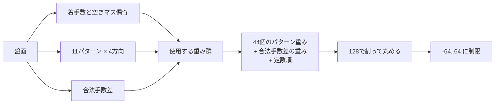
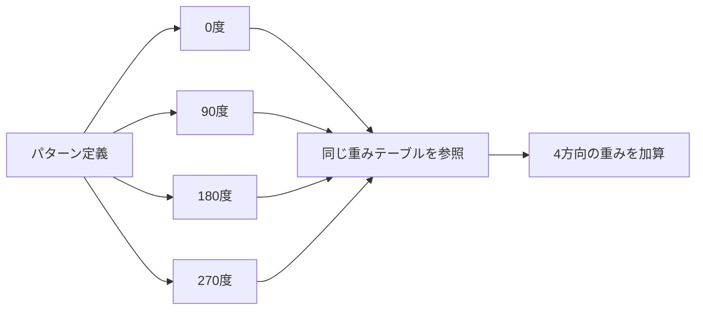
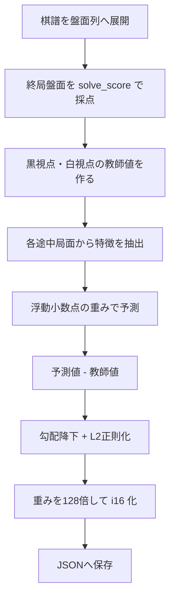

# 旧 Deft Reversi の評価関数

旧 `deft-reversi-engine` の評価関数を、書き直し版へ移植・検証するための資料です。コードから確認できる挙動を中心に説明し、設計意図の推測は明記して区別します。

## 目次

- [30秒で分かる概要](#30秒で分かる概要)
- [主評価の計算手順](#主評価の計算手順)
- [11種類の盤面パターン](#11種類の盤面パターン)
- [データ構造と関数の対応](#データ構造と関数の対応)
- [重みの学習](#重みの学習)
- [補助評価 `simplest_eval`](#補助評価-simplest_eval)
- [書き直し版へ移植するときの確認項目](#書き直し版へ移植するときの確認項目)

## 30秒で分かる概要

旧版の主評価関数は、盤面全体を直接採点するのではなく、次の三つを学習済みテーブルから引いて足します。

1. 11種類の部分盤面を4方向から見た重み（合計44回の参照）
2. 自分と相手の合法手数差の重み（1回の参照）
3. 定数項

合計は128で割って四捨五入し、探索用の `-64..64` に収めます。評価値は常に現在手番から見た値です。



旧版には、これとは別に move ordering 専用の手書き評価 `simplest_eval` があります。両者は役割も値の尺度も異なります。

| 評価関数 | 役割 | 呼び出される場所 |
| --- | --- | --- |
| `Evaluator::clac_features_eval` | 探索の葉で局面を評価 | `eval_search.rs` の `lv <= 0` など |
| `simplest_eval` | 候補手を高速に並べ替える | `move_list.rs` の `set_move_eval` |

> `clac` は旧実装の関数名に含まれる綴りです。この資料ではコードとの対応を優先して、そのまま記載します。

## 用語と視点

`Board` は石の色ではなく、手番を基準に盤面を保持します。

| フィールド | 意味 |
| --- | --- |
| `board.player` | 現在手番の石 |
| `board.opponent` | 相手の石 |

着手後に二つのフィールドを交換するため、評価値の正負も常に現在手番基準です。

```text
正の評価値  現在手番に有利
負の評価値  現在手番に不利
```

この表現は、子局面の値を反転する negamax と相性がよく、探索では概ね `score = -child_score` として利用されます。

## 主評価の計算手順

### 1. 使用する重み群を選ぶ

重みは、局面の進行度 `phase` と空きマス数の偶奇 `parity` ごとに分かれています。

```text
move_count = popcount(player | opponent) - 4    // 0..60
phase      = move_count / 2                     // 0..30
parity     = empties_count % 2                  // 0 または 1
```

`move_count` は盤上の石数から初期石4個を引いた値です。パスでは石数が変わらないため、パスを1手として数えません。

```text
move_count   0  1 | 2  3 | 4  5 | ... | 58 59 | 60
phase        0    | 1    | 2    | ... | 29    | 30
parity       0  1 | 0  1 | 0  1 | ... | 0  1  | 0
```

通常の対局では `empties_count = 60 - move_count` なので、空きマスの偶奇と着手数の偶奇は一致します。実装が実際に参照する式は、あくまで `empties_count() % 2` です。

### 2. パターンを三進数にする

パターンに含まれる各マスを、次の1桁へ変換します。

| マスの状態 | 三進数の桁 |
| --- | ---: |
| 空き | 0 |
| 相手の石 | 1 |
| 自分の石 | 2 |

マスを定義順に読み、左から三進数を組み立てます。

```text
feature = 0
for square in pattern:
    feature = feature * 3 + state(square)
```

例えば、3マスを「自分、相手、空き」の順で読んだ場合は次の番号になります。

```text
状態          自分  相手  空き
三進数の桁      2     1     0

feature = ((2 × 3) + 1) × 3 + 0
        = 21
        = 210₍₃₎
```

したがって、`n` マスのパターンには `3^n` 個の重みがあります。10マスなら `3^10 = 59,049` 個です。

### 3. 同じパターンを4方向から読む

各パターンは、0度・90度・180度・270度の4方向で評価されます。鏡映は別途追加していません。



回転後も「パターン定義内の何番目のマスか」は維持されます。三進数の桁順が変わると別の重みを参照するため、移植時は座標集合だけでなく順序も一致させる必要があります。

### 4. 合法手数差をテーブル参照する

合法手数差は、固定係数との掛け算ではなく、専用テーブルの添字になります。

```text
mobility_diff  = popcount(board.moves())
               - popcount(board.opponent_moves())

mobility_index = 64 + mobility_diff
mobility_score = mobility_eval[mobility_index]
```

`mobility_eval` は128要素で、有効な添字は `0..127` です。実際の合法局面で生じる合法手数差を、64を中心とした添字へ変換する設計です。単純な算術上限だけを使うと128に達し得るように見えますが、実装には範囲検査がないため、書き直し版では到達可能範囲をテストで保証するか、安全な参照にするのが望ましいです。

例：自分に9手、相手に6手の合法手がある場合

```text
mobility_diff  = 9 - 6 = 3
mobility_index = 64 + 3 = 67
```

このとき `mobility_eval[67]` を加算します。差が同じでも `phase` と `parity` が違えば、参照するテーブルも値も異なります。

### 5. すべてを足し、探索用スコアへ変換する

局面 `b`、偶奇 `q`、進行度 `p` に対する生スコアは次の式です。

```text
raw(b) = Σ pattern=0..10 Σ rotation=0..3
             pattern_eval[q][p][pattern][feature(pattern, rotation, b)]
         + mobility_eval[q][p][64 + own_moves - opponent_moves]
         + const_eval[q][p]
```

その後、内部単位から探索の単位へ変換します。

```text
raw > 0 のとき  score = (raw + 64) / 128
raw < 0 のとき  score = (raw - 64) / 128
raw = 0 のとき  score = 0

最終値 = clamp(score, -64, 64)
```

Rustの整数除算は0方向へ切り捨てるため、これは絶対値を最も近い整数へ丸め、ちょうど半分なら0から遠い側へ丸める処理です。

| `raw` | 変換後 |
| ---: | ---: |
| -193 | -2 |
| -192 | -2 |
| -64 | -1 |
| -63 | 0 |
| 0 | 0 |
| 63 | 0 |
| 64 | 1 |
| 192 | 2 |
| 193 | 2 |

変換後に `-64..64` へ制限します。教師値が終局の石差なので、変換後の1点はおおむね最終石差1個分を予測する単位です。ただし途中局面ではあくまで推定値です。主評価の上限 `+64` も終局の最大石差と同じ尺度を意識したものと考えられますが、後半は定数と利用方法からの推測です。

## 11種類の盤面パターン

図中の `X` が読むマス、`.` が読まないマスです。各図は左上から `A1..H1`、次の行が `A2..H2` という向きです。

```text
Pattern 1         Pattern 2         Pattern 3
X.XXXX.X          XXXXXXXX          X......X
..XXXX..          .X....X.          XXXXXXXX
........          ........          ........
........          ........          ........
........          ........          ........
........          ........          ........
........          ........          ........
........          ........          ........

Pattern 4         Pattern 5         Pattern 6
........          ........          XXX.....
........          ........          XXX.....
XXXXXXXX          ........          XXX.....
........          XXXXXXXX          ........
........          ........          ........
........          ........          ........
........          ........          ........
........          ........          ........

Pattern 7         Pattern 8         Pattern 9
XXXX....          XX..X...          .....X..
XXX.....          XX.X....          ....X...
XX......          ..X.....          ...X....
X.......          .X......          ..X.....
........          X.......          .X......
........          ........          X.......
........          ........          ........
........          ........          ........

Pattern 10        Pattern 11
......X.          .......X
.....X..          ......X.
....X...          .....X..
...X....          ....X...
..X.....          ...X....
.X......          ..X.....
X.......          .X......
........          X.......
```

基準方向における正確な読み取り順は次のとおりです。この順番が三進数の上位桁から下位桁に対応します。

| No. | 基準方向の座標（左から読み取り） | マス数 | 状態数 `3^n` |
| ---: | --- | ---: | ---: |
| 1 | A1, C1, D1, E1, F1, H1, C2, D2, E2, F2 | 10 | 59,049 |
| 2 | A1, B1, C1, D1, E1, F1, G1, H1, B2, G2 | 10 | 59,049 |
| 3 | A1, H1, A2, B2, C2, D2, E2, F2, G2, H2 | 10 | 59,049 |
| 4 | A3, B3, C3, D3, E3, F3, G3, H3 | 8 | 6,561 |
| 5 | A4, B4, C4, D4, E4, F4, G4, H4 | 8 | 6,561 |
| 6 | A1, B1, C1, A2, B2, C2, A3, B3, C3 | 9 | 19,683 |
| 7 | A1, B1, C1, D1, A2, B2, C2, A3, B3, A4 | 10 | 59,049 |
| 8 | A1, B1, E1, A2, B2, D2, C3, B4, A5 | 9 | 19,683 |
| 9 | F1, E2, D3, C4, B5, A6 | 6 | 729 |
| 10 | G1, F2, E3, D4, C5, B6, A7 | 7 | 2,187 |
| 11 | H1, G2, F3, E4, D5, C6, B7, A8 | 8 | 6,561 |

1つの `EvaluationScores` は、合計298,161個のパターン重み、128個の合法手数差重み、1個の定数項を持ちます。これが `2 parity × 31 phase` 存在するため、論理上の重みは18,493,980個です。`i16` の値だけで約35.3 MiB、JSON形式の [`eval.json`](../data/eval/eval.json) は約49 MiBです。

## データ構造と関数の対応

```text
Evaluator
├── eval[2][31] : EvaluationScores
│   ├── pattern_eval[11][3^n] : i16
│   ├── mobility_eval[128]     : i16
│   └── const_eval             : i16
└── feature_bit[11][4]         : u16  // 現在の盤面から計算した添字
```

| 処理 | 旧実装 |
| --- | --- |
| パターン座標と定数 | `eval.rs::evaluator_const` |
| 44個の特徴番号を計算 | `Evaluator::clac_features` |
| 重みを合計 | `Evaluator::calc_eval` |
| 特徴計算、128除算、丸め、制限 | `Evaluator::clac_features_eval` |
| 探索の葉から呼び出す | `eval_search.rs::negaalpha_eval_no_mo` |
| JSONを読み書き | `Evaluator::read_file` / `write_file` |

盤面1個を評価する処理を擬似コードにすると、次のようになります。

```text
function evaluate(board):
    phase  = board.move_count() / 2
    parity = board.empties_count() % 2
    weights = evaluator.eval[parity][phase]

    raw = 0
    for pattern in 0..11:
        for rotation in 0..4:
            feature = encode_base3(board, pattern, rotation)
            raw += weights.pattern_eval[pattern][feature]

    mobility = 64 + count(board.moves()) - count(board.opponent_moves())
    raw += weights.mobility_eval[mobility]
    raw += weights.const_eval

    return clamp(round_half_away_from_zero(raw, unit=128), -64, 64)
```

## 重みの学習

旧 README は、Egaroucidの自己対戦棋譜を学習データに使ったと説明しています。`learn.rs` と `eval_for_learn.rs` に残る学習処理は、概ね次の流れです。



目的関数は概念的には次の形です。

```text
loss = (evaluation - correct_score)^2 + λ × Σ weight^2
```

- 学習率は基本 `0.00004`
- 20手未満では学習率を3分の1にする
- L2正則化係数 `λ` は `0.000002`
- 2手未満の局面は学習対象外
- 保存時に浮動小数点の重みを128倍し、`i16` へ変換

### 旧学習コードの不整合

ここは移植時に最も注意が必要です。コード上、2種類の重み群の選択方法が揃っていません。

| 箇所 | 選択方法 |
| --- | --- |
| 学習ループの更新先 | `eval[board.next_turn][phase]` |
| 学習時の予測 `EvaluatorForLearn::clac_eval` | 常に `eval[0][phase]` |
| 実行時の評価 `Evaluator::calc_eval` | `eval[empties_count % 2][phase]` |

したがって、「2種類の添字が本来何を表すべきだったか」はコードだけでは一意に確定できません。実行時の完全互換を優先するなら `empties_count % 2` を再現し、学習器を作り直すなら予測・更新・実行で同じ定義へ統一する必要があります。

## 補助評価 `simplest_eval`

`simplest_eval` は、主評価の軽量版ではありません。候補手の探索順を早く決めるための、独立した手書きヒューリスティックです。

### 通常局面の式

```text
place_score
    = 固定位置点の自分合計 - 相手合計
    + 辺に関する追加点

piece_count_score
    = 相手の石数 - 自分の石数    // 総石数が40未満のときだけ

mobility_score
    = 自分の合法手数 - 相手の合法手数

simple_score
    = (place_score × 10
       + mobility_score × 85
       + piece_count_score × 40) / 40
```

固定位置点は次のとおりです。

```text
       A    B    C    D    E    F    G    H
 1   120  -40    1    0    0    1  -40  120
 2   -40  -60   -5   -4   -4   -5  -60  -40
 3     1   -5   -1   -2   -2   -1   -5    1
 4     0   -4   -2   -1   -1   -2   -4    0
 5     0   -4   -2   -1   -1   -2   -4    0
 6     1   -5   -1   -2   -2   -1   -5    1
 7   -40  -60   -5   -4   -4   -5  -60  -40
 8   120  -40    1    0    0    1  -40  120
```

角を大きく加点し、角に隣接する危険なマスを大きく減点する形です。この固定位置点は、角がすでに埋まったかどうかでは変化しません。また序盤は「自分の石が少ない」ことを加点します。これは石数より可動性を重視する典型的な序盤ヒューリスティックです。

辺については、各辺の占有状態に応じた `+120/-120` と、辺がすべて埋まったときの石数差 `×20` も `place_score` に加えます。

### 終局時の特殊値

双方に合法手がないときは、上の式を使いません。

```text
自分の石数 > 相手の石数 なら +1000
それ以外                  なら -1000
```

旧コードでは引き分けも `-1000` です。主探索の終局評価 `solve_score` は引き分けを0にするため、両者の挙動は一致しません。ただし `simplest_eval` は move ordering 用なので、この値を対局結果として返す設計ではありません。

## 書き直し版へ移植するときの確認項目

### 完全互換に必要な項目

- [ ] `player` を現在手番、`opponent` を相手として符号化する
- [ ] `empty=0, opponent=1, player=2` の三進数にする
- [ ] 11パターンの座標だけでなく、マスの読み取り順も合わせる
- [ ] 4回転のみを使い、意図せず鏡映を追加しない
- [ ] `phase = (occupied - 4) / 2` とする
- [ ] 実行時の重み群を `empties_count % 2` で選ぶ
- [ ] 合法手数差の添字を `64 + own - opponent` とする
- [ ] 生スコアを128単位で half-away-from-zero 丸めする
- [ ] 最終評価値を `-64..64` に制限する
- [ ] パスで `phase` を進めない

### テストしておきたい性質

- [ ] 旧版と新版で、同じ盤面の44個の特徴番号がすべて一致する
- [ ] 初期局面、パス局面、終盤局面で `phase` と `parity` が一致する
- [ ] `raw = -64, -63, 63, 64` の丸め境界が一致する
- [ ] 合法局面の `mobility_index` が常に配列範囲内にある
- [ ] 盤面を90度回転しても総評価値が変わらない
- [ ] 旧 `eval.json` を読み込んだ評価値が旧版と一致する

## 書き直し版との対応

この文書は旧実装を調べた時点の記録であり、上のチェックリストは現在の実装状況を表すものではない。新実装のパターン定義は [`definition.rs`](../deft-reversi-engine/src/evaluation/pattern/definition.rs)、現在の読込形式や差分評価は[エンジンREADME](../deft-reversi-engine/README.md)を参照。

## 参照した実装

- [`deft-reversi-engine/src/eval.rs`](https://github.com/ikepggthb/deft-reversi/blob/5a17bdce4a0803cb59e49c39977a5bfc0bb3f021/deft-reversi-engine/src/eval.rs) — 実行時の主評価
- [`deft-reversi-engine/src/eval_for_learn.rs`](https://github.com/ikepggthb/deft-reversi/blob/5a17bdce4a0803cb59e49c39977a5bfc0bb3f021/deft-reversi-engine/src/eval_for_learn.rs) — 学習用の浮動小数点評価
- [`deft-reversi-engine/src/learn.rs`](https://github.com/ikepggthb/deft-reversi/blob/5a17bdce4a0803cb59e49c39977a5bfc0bb3f021/deft-reversi-engine/src/learn.rs) — 棋譜処理と重み更新
- [`deft-reversi-engine/src/eval_simple.rs`](https://github.com/ikepggthb/deft-reversi/blob/5a17bdce4a0803cb59e49c39977a5bfc0bb3f021/deft-reversi-engine/src/eval_simple.rs) — move ordering用の補助評価
- [`deft-reversi-engine/src/eval_search.rs`](https://github.com/ikepggthb/deft-reversi/blob/5a17bdce4a0803cb59e49c39977a5bfc0bb3f021/deft-reversi-engine/src/eval_search.rs) — 主評価の呼び出し元
- [`deft-reversi-engine/src/move_list.rs`](https://github.com/ikepggthb/deft-reversi/blob/5a17bdce4a0803cb59e49c39977a5bfc0bb3f021/deft-reversi-engine/src/move_list.rs) — 補助評価の呼び出し元
- [`data/eval/eval.json`](../data/eval/eval.json) — 学習済み重み
